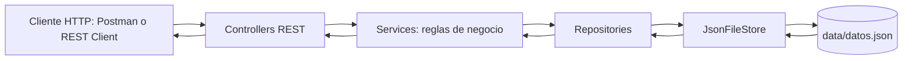

# [TÍTULO DEL INFORME]

**Asignatura:** Desarrollo de Software Web II  
**Institución:** IPSS  
**Logo:** [INSERTAR LOGO IPSS]  
**Profesor/a:** [NOMBRE DEL/DE LA PROFESOR/A]  
**Integrantes:** [NOMBRES DE LOS INTEGRANTES — COMPLETAR POR EL GRUPO]  
**Fecha:** [COMPLETAR]  
**Archivo final sugerido:** `EVU2_GRUPO_APELLIDO_NOMBRE`

> Borrador para trasladar a Word/PDF. No se completan nombres ni datos de portada que no constan en el proyecto.

## Índice

1. [Introducción](#3-introducción)
2. [Desarrollo](#4-desarrollo)
   - [4.1 Arquitectura CSR](#41-arquitectura-csr)
   - [4.2 Modelo de datos](#42-modelo-de-datos)
   - [4.3 Persistencia en JSON](#43-persistencia-en-json)
   - [4.4 Explicación del código por archivo](#44-explicación-del-código-por-archivo)
   - [4.5 Endpoints REST](#45-endpoints-rest)
   - [4.6 Validaciones y manejo de errores](#46-validaciones-y-manejo-de-errores)
   - [4.7 Pruebas y evidencias](#47-pruebas-y-evidencias)
3. [Conclusión](#5-conclusión)
4. [Bibliografía](#6-bibliografía)
5. [Listado de archivos del proyecto](#7-listado-de-archivos-del-proyecto)

## 3. Introducción

Sabor Gourmet necesita reemplazar la gestión manual de reservas por una API que permita al personal administrar clientes y mesas, revisar disponibilidad y crear, consultar, modificar o cancelar reservas. La aplicación no incluye interfaz gráfica: los consumidores interactúan mediante solicitudes HTTP y reciben respuestas JSON. Los datos se guardan en `data/datos.json` para conservarlos entre ejecuciones.

El objetivo del proyecto es implementar esos casos de uso con Java 21 y Spring Boot 4.1.2, separando el transporte HTTP, las reglas de negocio y el acceso al almacenamiento mediante la arquitectura Controller–Service–Repository (CSR). La API escucha en el puerto 8080 y acepta solicitudes bajo `/api`.

## 4. Desarrollo

### 4.1 Arquitectura CSR

El flujo principal es Controller → Service → Repository → almacenamiento JSON. Las respuestas regresan desde la capa de almacenamiento hasta el consumidor HTTP. Los controllers no acceden a repositories y los servicios no dependen de clases web.



- **Controllers:** reciben parámetros y cuerpos HTTP, invocan `@Valid` cuando corresponde y construyen `ResponseEntity` con el estado y cuerpo de respuesta.
- **Services:** verifican reglas del dominio y coordinan el trabajo entre repositorios. Por ejemplo, `ReservaService` revisa referencias, capacidad, horario y solapamientos antes de guardar.
- **Repositories:** consultan y modifican sus colecciones del contenedor `DatosRestaurante` a través del componente común `JsonFileStore`.
- **Almacenamiento:** Jackson convierte entre objetos Java y JSON. `JsonFileStore` sincroniza las operaciones dentro de la instancia y reemplaza el archivo mediante un temporal.

`CSR` significa Controller–Service–Repository en este proyecto; no es una aplicación de renderizado del lado del cliente. No hay base de datos, JPA, plantillas ni interfaz gráfica.

### 4.2 Modelo de datos

El documento JSON tiene un objeto raíz con tres arreglos: `clientes`, `mesas` y `reservas`. Los identificadores se asignan dentro de cada colección; las reservas conservan las relaciones mediante `clienteId` y `mesaId`, no mediante objetos anidados. Una reserva tiene estado `ACTIVA` o `CANCELADA`; solo las activas ocupan disponibilidad. Al cancelar se conserva el registro histórico.

Modelo de reserva representativo:

```json
{
  "id": 1,
  "clienteId": 1,
  "mesaId": 2,
  "fecha": "2026-12-05",
  "hora": "20:00",
  "duracionMinutos": 120,
  "cantidadPersonas": 4,
  "estado": "ACTIVA"
}
```

En el archivo de ejemplo hay dos clientes, tres mesas (con capacidades 2, 4 y 6) y dos reservas activas. Los clientes almacenan ID, nombre, correo y teléfono; las mesas, ID, número, capacidad y ubicación. La clase `Reserva` guarda fecha y hora locales, duración, cantidad de personas y estado. La duración fija se asigna desde configuración, no se recibe en el DTO de reserva.

Las relaciones por ID se verifican al crear o modificar una reserva. Una eliminación de cliente o mesa se rechaza si existe cualquier reserva que la referencia, incluso si está cancelada, para preservar la integridad del historial. El número visible de mesa es único.

### 4.3 Persistencia en JSON

`application.properties` fija la ruta `data/datos.json`. En la inicialización, `JsonFileStore` crea los directorios necesarios; si el archivo no existe, escribe un `DatosRestaurante` con las tres listas vacías. Si ya existe, lo lee y verifica que el objeto raíz y las tres colecciones no sean nulos; no lo sustituye por datos vacíos.

Cada lectura vuelve a deserializar el archivo. Una modificación toma el bloqueo de escritura, lee el estado actual, aplica el cambio y guarda el objeto resultante. Las lecturas usan el bloqueo de lectura. Antes de guardar se verifica la estructura; Jackson escribe en un archivo temporal hermano (`datos.json.tmp`) y el componente intenta moverlo al destino con `ATOMIC_MOVE` y reemplazo. Si el sistema de archivos no soporta el movimiento atómico, usa reemplazo sin esa garantía. El temporal se elimina en un `finally`; si falla el cambio antes del guardado, no se escribe la modificación.

Los errores de lectura, estructura o escritura se convierten en `PersistenciaException`, registran la causa técnica en el servidor y producen una respuesta HTTP genérica 500. El JSON corrupto no se inicializa encima: la prueba de repositorio comprueba que sus bytes originales se conservan. El bloqueo de lectura/escritura pertenece a una instancia de `JsonFileStore`; no coordina procesos o réplicas distintas.

**Limitaciones conocidas:** la coordinación de operaciones de reserva mediante `synchronized` es por instancia de `ReservaService`; junto con el bloqueo local del archivo, el diseño está pensado para una única instancia de aplicación. Varias réplicas necesitarían coordinación compartida. Los IDs se calculan como el máximo ID aún presente más uno por colección; al borrar el registro con el ID más alto de clientes o mesas, ese ID puede reutilizarse en una creación posterior. Las reservas no se borran, por lo que conservan sus IDs históricos.

### 4.4 Explicación del código por archivo

#### Construcción y archivo de ejemplo

##### `pom.xml`
Declara `com.saborgourmet:reservas`, Java 21 y Spring Boot 4.1.2, con las dependencias MVC, Bean Validation, Lombok y pruebas MVC. El plugin de Spring Boot excluye Lombok del empaquetado; Failsafe ejecuta las pruebas de integración en las fases `integration-test` y `verify`.

##### `.mvn/wrapper/maven-wrapper.properties`
Fija Maven Wrapper 3.3.4 en modo `only-script` y la distribución Maven 3.10.1 que usarán los scripts del wrapper.

##### `mvnw`
Script de shell para ejecutar el Maven configurado por el wrapper en sistemas tipo Unix.

##### `mvnw.cmd`
Script de Windows para ejecutar la distribución Maven configurada por el wrapper.

##### `data/datos.json`
Archivo de ejemplo con dos clientes, tres mesas de capacidades 2, 4 y 6, y dos reservas activas con fechas futuras.

#### Arranque y configuración

##### `src/main/java/com/saborgourmet/reservas/ReservasApplication.java`
Clase de entrada Spring Boot: habilita el escaneo de componentes y la carga de `ReservasProperties`, y su `main` inicia el servidor integrado.

##### `src/main/java/com/saborgourmet/reservas/config/ClockConfig.java`
Expone `Clock.systemDefaultZone()` como bean. Los servicios reciben el reloj para validar fechas respecto de la hora actual; las pruebas unitarias pueden suministrar `Clock.fixed(...)` para evaluar esas reglas de forma determinista.

##### `src/main/java/com/saborgourmet/reservas/config/ReservasProperties.java`
Agrupa bajo `app.reservas` la duración y horas de atención; Bean Validation exige que duración y horas estén presentes y que los minutos sean positivos.

##### `src/main/resources/application.properties`
Configura nombre, puerto 8080, `data/datos.json`, duración de 120 minutos, atención de 12:00 a 23:00, formato JSON y exclusión de información interna de errores.

#### Controladores

##### `src/main/java/com/saborgourmet/reservas/controller/ClienteController.java`
Define `GET`, `POST`, `PUT` y `DELETE` para `/api/clientes`. Delegación al servicio; la creación devuelve `201 Created` con `Location`, y la eliminación exitosa devuelve `204 No Content`.

##### `src/main/java/com/saborgourmet/reservas/controller/MesaController.java`
Expone CRUD de `/api/mesas` y `GET /api/mesas/disponibles`. Convierte `fecha` ISO, `hora` en formato `HH:mm` y `personas` en parámetros tipados, delegando disponibilidad al servicio.

##### `src/main/java/com/saborgourmet/reservas/controller/ReservaController.java`
Expone listado con filtros combinables, consulta individual, creación, modificación y `PATCH /api/reservas/{id}/cancelar`. Usa `ResponseEntity` para estados y respuestas; no implementa reglas de negocio.

##### `src/main/java/com/saborgourmet/reservas/controller/package-info.java`
Documenta el paquete de adaptadores HTTP (controllers) dentro de CSR.

#### Servicios

##### `src/main/java/com/saborgourmet/reservas/service/ClienteService.java`
Implementa operaciones de cliente y evita eliminar clientes referenciados por reservas. Mapea `ClienteRequest` al modelo y conserva el ID al actualizar.

##### `src/main/java/com/saborgourmet/reservas/service/MesaService.java`
Administra mesas, exige número único y no permite reducir capacidad por debajo de una reserva activa futura. La consulta de disponibilidad filtra por capacidad y por reservas activas que se solapan; el inicio y fin se calculan con la duración configurada.

##### `src/main/java/com/saborgourmet/reservas/service/ReservaService.java`
Valida referencias, fecha y hora futuras, horario de atención, capacidad y solapamiento de la misma mesa. La duración proviene de propiedades. Modificar solo permite reservas activas y excluye la reserva actual de su comprobación de conflicto; cancelar cambia estado y conserva el registro. Los métodos de crear, modificar y cancelar son `synchronized`, lo cual solo coordina llamadas en esa instancia.

##### `src/main/java/com/saborgourmet/reservas/service/package-info.java`
Documenta el paquete que contiene casos de uso y reglas de negocio.

#### Repositories y persistencia

##### `src/main/java/com/saborgourmet/reservas/repository/ClienteRepository.java`
Consulta, busca, guarda y elimina clientes en la lista del JSON. Cuando crea, asigna ID a partir del máximo ID presente más uno.

##### `src/main/java/com/saborgourmet/reservas/repository/MesaRepository.java`
Accede a la lista de mesas y permite buscar por ID y por número, guardar con ID y eliminar por ID. Toda modificación pasa por `JsonFileStore`.

##### `src/main/java/com/saborgourmet/reservas/repository/ReservaRepository.java`
Accede a reservas; consulta por ID, por mesa y fecha, y comprueba referencias desde clientes y mesas. La búsqueda de asociaciones contempla también reservas canceladas.

##### `src/main/java/com/saborgourmet/reservas/repository/JsonFileStore.java`
Único componente que administra el archivo: inicializa, lee y modifica el objeto raíz, valida que existan las tres listas, protege operaciones con `ReentrantReadWriteLock` y guarda mediante temporal y reemplazo.

##### `src/main/java/com/saborgourmet/reservas/repository/package-info.java`
Documenta la capa Repository y su responsabilidad de acceso a los datos.

#### Modelo y contratos HTTP

##### `src/main/java/com/saborgourmet/reservas/model/Cliente.java`
Entidad persistida de cliente con `id`, `nombre`, `email` y `telefono`. Ignora propiedades JSON desconocidas para tolerar campos antiguos; la prueba cubre el campo obsoleto `identificacion`.

##### `src/main/java/com/saborgourmet/reservas/model/Mesa.java`
Entidad de mesa con ID, número visible, capacidad y ubicación.

##### `src/main/java/com/saborgourmet/reservas/model/Reserva.java`
Entidad de reserva con referencias por ID, fecha, hora, duración, personas y estado. La hora se representa como `HH:mm`.

##### `src/main/java/com/saborgourmet/reservas/model/DatosRestaurante.java`
Objeto raíz de serialización que contiene e inicializa las listas de clientes, mesas y reservas.

##### `src/main/java/com/saborgourmet/reservas/model/EstadoReserva.java`
Enum con `ACTIVA` y `CANCELADA`, empleado para controlar si una reserva bloquea disponibilidad.

##### `src/main/java/com/saborgourmet/reservas/model/package-info.java`
Documenta el paquete del modelo de dominio.

##### `src/main/java/com/saborgourmet/reservas/dto/ClienteRequest.java`
Record de entrada para alta y actualización de cliente. `@NotBlank` valida nombre, email y teléfono; `@Email` valida el formato del correo.

##### `src/main/java/com/saborgourmet/reservas/dto/MesaRequest.java`
Record de entrada de mesa. Exige número y capacidad positivos; ubicación es opcional.

##### `src/main/java/com/saborgourmet/reservas/dto/ReservaRequest.java`
Record de entrada que exige IDs positivos de cliente y mesa, fecha, hora y cantidad positiva de personas. No permite que el consumidor fije ID, duración o estado.

##### `src/main/java/com/saborgourmet/reservas/dto/ErrorResponse.java`
Estructura común de error: marca temporal, código y texto HTTP, mensaje seguro, ruta y lista de detalles.

##### `src/main/java/com/saborgourmet/reservas/dto/package-info.java`
Documenta el paquete de objetos que forman los contratos de entrada y salida.

#### Errores

##### `src/main/java/com/saborgourmet/reservas/exception/GlobalExceptionHandler.java`
`@RestControllerAdvice` traduce excepciones de negocio y de MVC a `ErrorResponse`. Ordena los errores de validación por campo y devuelve mensajes genéricos para errores internos, sin trazas en la respuesta.

##### `src/main/java/com/saborgourmet/reservas/exception/ConflictoException.java`
Excepción de dominio que el manejador global traduce a 409 Conflict.

##### `src/main/java/com/saborgourmet/reservas/exception/SolicitudInvalidaException.java`
Excepción para reglas de negocio incumplidas, traducida a 400 Bad Request.

##### `src/main/java/com/saborgourmet/reservas/exception/RecursoNoEncontradoException.java`
Excepción para recursos inexistentes, traducida a 404 Not Found.

##### `src/main/java/com/saborgourmet/reservas/exception/PersistenciaException.java`
Conserva la causa técnica para logs internos cuando falla el almacenamiento; la respuesta externa no expone esa causa.

##### `src/main/java/com/saborgourmet/reservas/exception/package-info.java`
Documenta el paquete de excepciones y su traducción a respuestas HTTP.

#### Pruebas automatizadas

##### `src/test/java/com/saborgourmet/reservas/ReservasApplicationTests.java`
Carga el contexto de Spring y redirige `app.datos.ruta` a `@TempDir`; el caso `contextLoads` comprueba el arranque sin tocar los datos del proyecto.

##### `src/test/java/com/saborgourmet/reservas/controller/ClienteControllerTest.java`
Usa `@WebMvcTest`, `MockMvc` y un `ClienteService` simulado para verificar CRUD, códigos HTTP, `Location`, validación del cuerpo y traducción de errores 404/409 y de un ID mal formado.

##### `src/test/java/com/saborgourmet/reservas/controller/MesaControllerTest.java`
Comprueba el CRUD HTTP, `Location`, validaciones y errores del servicio; además verifica que `/disponibles` se resuelva como ruta literal y convierta fecha y hora a tipos Java.

##### `src/test/java/com/saborgourmet/reservas/controller/ReservaControllerTest.java`
Prueba consultas, filtros, creación, modificación y cancelación con `MockMvc`; comprueba respuestas 201/200, detalles de validación y errores 404/409.

##### `src/test/java/com/saborgourmet/reservas/controller/package-info.java`
Documenta el paquete de pruebas MVC de los controllers.

##### `src/test/java/com/saborgourmet/reservas/exception/GlobalExceptionHandlerTest.java`
Construye un `MockMvc` con un controller mínimo para verificar estados y formato de errores de negocio, validación, JSON/parámetros ilegibles y fallos internos sin trazas.

##### `src/test/java/com/saborgourmet/reservas/integracion/FlujoCompletoIT.java`
Levanta la aplicación completa con `@SpringBootTest` y `MockMvc`, usa un archivo temporal y cubre CRUD, ciclo de reserva, disponibilidad, errores y persistencia al crear una nueva instancia del almacenamiento.

##### `src/test/java/com/saborgourmet/reservas/integracion/package-info.java`
Documenta el paquete de pruebas de integración.

##### `src/test/java/com/saborgourmet/reservas/model/ModeloYDtoTests.java`
Verifica el ciclo de serialización JSON con fechas y horas ISO, la lectura tolerante a un campo antiguo y las restricciones Bean Validation de los DTOs.

##### `src/test/java/com/saborgourmet/reservas/repository/JsonFileStoreTest.java`
Usa `@TempDir` para comprobar la inicialización, lectura desde otra instancia, asignación de IDs, reemplazo por ID, preservación de JSON corrupto y limpieza del archivo temporal.

##### `src/test/java/com/saborgourmet/reservas/repository/package-info.java`
Documenta el paquete de pruebas de persistencia y repositories.

##### `src/test/java/com/saborgourmet/reservas/service/ClienteServiceTest.java`
Con repositories simulados, verifica la creación y actualización de clientes, el manejo de IDs inexistentes y el conflicto al eliminar un cliente con reservas.

##### `src/test/java/com/saborgourmet/reservas/service/MesaServiceTest.java`
Usa `Clock.fixed(...)` y repositories simulados para comprobar reglas de mesas, unicidad del número, integridad referencial, capacidad futura y disponibilidad.

##### `src/test/java/com/saborgourmet/reservas/service/ReservaServiceTest.java`
Usa `Clock.fixed(...)` y dobles de repositories para verificar referencias, fechas, horario, capacidad, solapamientos (incluidos intervalos contiguos), modificación y cancelación.

##### `src/test/java/com/saborgourmet/reservas/service/package-info.java`
Documenta el paquete de pruebas unitarias de Service.

### 4.5 Endpoints REST

Las solicitudes y respuestas que incluyen cuerpo usan JSON. Los `POST` exitosos responden con `201 Created` y un encabezado `Location`; los `PUT` y la cancelación devuelven el recurso actualizado; las eliminaciones correctas responden `204` sin cuerpo.

| Método y ruta | Función | Respuestas principales |
|---|---|---|
| `GET /api/clientes` | Lista clientes. | 200 |
| `GET /api/clientes/{id}` | Consulta cliente. | 200, 404 |
| `POST /api/clientes` | Crea cliente. | 201, 400 |
| `PUT /api/clientes/{id}` | Reemplaza datos del cliente indicado. | 200, 400, 404 |
| `DELETE /api/clientes/{id}` | Elimina cliente sin reservas asociadas. | 204, 404, 409 |
| `GET /api/mesas` | Lista mesas. | 200 |
| `GET /api/mesas/{id}` | Consulta mesa. | 200, 404 |
| `POST /api/mesas` | Crea mesa con número único. | 201, 400, 409 |
| `PUT /api/mesas/{id}` | Actualiza mesa. | 200, 400, 404, 409 |
| `DELETE /api/mesas/{id}` | Elimina mesa sin reservas asociadas. | 204, 404, 409 |
| `GET /api/mesas/disponibles?fecha=AAAA-MM-DD&hora=HH:mm&personas=n` | Busca mesas con capacidad suficiente y turno libre. | 200, 400 |
| `GET /api/reservas` | Lista reservas; filtros opcionales `fecha`, `estado`, `clienteId`, `mesaId`, combinados como AND. | 200, 400 si un filtro no se convierte |
| `GET /api/reservas/{id}` | Consulta reserva. | 200, 404 |
| `POST /api/reservas` | Crea reserva activa. | 201, 400, 404, 409 |
| `PUT /api/reservas/{id}` | Modifica reserva activa. | 200, 400, 404, 409 |
| `PATCH /api/reservas/{id}/cancelar` | Cambia su estado a cancelada sin borrar el historial. | 200, 404, 409 |

Ejemplo de creación de reserva:

```http
POST /api/reservas
Content-Type: application/json

{
  "clienteId": 1,
  "mesaId": 1,
  "fecha": "2026-12-07",
  "hora": "19:00",
  "cantidadPersonas": 2
}
```

La configuración de ejemplo establece una duración de 120 minutos. En la evidencia manual, la respuesta de ejemplo fue `201`, `Location: /api/reservas/3` y cuerpo:

```json
{"id":3,"clienteId":1,"mesaId":1,"fecha":"2026-12-07","hora":"19:00","duracionMinutos":120,"cantidadPersonas":2,"estado":"ACTIVA"}
```

Cancelación, con método y ruta implementados:

```http
PATCH /api/reservas/3/cancelar
```

Respuesta observada: `200 OK` y el mismo recurso con `"estado":"CANCELADA"`. Un segundo intento de cancelación responde 409. `GET /api/mesas/disponibles` vuelve a incluir esa mesa para el turno liberado.

El formato común de error es, por ejemplo:

```json
{
  "timestamp": "2026-11-20T11:29:11.5099028",
  "status": 400,
  "error": "Bad Request",
  "mensaje": "La solicitud contiene campos inválidos",
  "ruta": "/api/clientes",
  "detalles": [
    "email: El correo electrónico debe tener un formato válido",
    "nombre: El nombre es obligatorio",
    "telefono: El teléfono es obligatorio"
  ]
}
```

El timestamp y los tres detalles corresponden al caso 24 de `docs/evidencias.md`; otros detalles cambian según la solicitud. La creación devuelve `Location` relativo al recurso, como aparece en las evidencias.

### 4.6 Validaciones y manejo de errores

Las validaciones de formato de entrada se declaran en los records DTO y se ejecutan con `@Valid` en controllers. Los servicios aplican las reglas que requieren consultar datos: fechas y horas, capacidad, referencias existentes, números de mesa únicos, reservas superpuestas y estado actual de la reserva. Para el horario se considera el intervalo completo según la duración configurada (120 minutos por defecto) y la atención de 12:00 a 23:00; intervalos contiguos se permiten, el solapamiento requiere intersección entre intervalos.

| HTTP | Causa tratada | Ejemplo comprobado |
|---:|---|---|
| 400 Bad Request | Restricciones Bean Validation o solicitud/regla inválida. También parámetro obligatorio ausente, fecha/hora o tipo con formato incorrecto, reserva pasada, fuera de horario o con más personas que capacidad. | `POST /api/clientes` con nombre y teléfono vacíos y email inválido; `GET /api/mesas/disponibles` sin `personas`. |
| 404 Not Found | No existe el recurso solicitado o no existe una referencia de cliente/mesa usada en una reserva. | `GET /api/reservas/999999` o una reserva con `clienteId` inexistente. |
| 409 Conflict | El estado actual impide completar la operación. | Número de mesa duplicado, reserva superpuesta, borrar cliente/mesa con reservas, volver a cancelar o modificar una reserva cancelada. |
| 500 Internal Server Error | Fallo de lectura/escritura JSON u otro error no controlado. La respuesta es genérica; la causa se conserva solo en los logs. | No se registró un caso 500 en las evidencias manuales. |

Las respuestas de error usan `timestamp`, `status`, `error`, `mensaje`, `ruta` y `detalles`. El manejador captura errores de validación, cuerpo JSON ilegible, tipos de parámetros, parámetro faltante, excepciones de dominio, persistencia y excepciones inesperadas. No se envía traza ni mensaje interno de excepción al consumidor.

### 4.7 Pruebas y evidencias

El proyecto incluye pruebas automatizadas en `src/test/java` para contexto de Spring, controladores, reglas de servicios, serialización/validación, persistencia, manejo global de errores e integración de flujos. Los casos de integración emplean una ruta JSON temporal, separada de `data/datos.json`. Los fuentes cubren, entre otros, CRUD de clientes/mesas, reglas de capacidad y solapamiento, consultas de disponibilidad, cancelación, filtros y persistencia tras recrear el almacenamiento. En esta fase se ejecutó `mvn clean test`: `BUILD SUCCESS`, 51 pruebas, 0 fallas, 0 errores y 0 omitidas (20 de noviembre de 2026). `mvn clean verify` queda como criterio de la Fase 11.

`docs/evidencias.md` registra una ejecución manual del **20 de noviembre de 2026** en `http://localhost:8080`, con zona horaria `-03:00`. Se recorrieron las 42 solicitudes de la colección Postman v2.1, en orden, mediante un cliente HTTP basado en la biblioteca estándar `urllib` de Python; se compararon los estados con los esperados de las solicitudes y se verificaron respuestas de disponibilidad: **42/42 estados esperados**. El documento deja explícito que no se ejecutó Postman/Newman (Newman no estaba disponible en `PATH`); es un recorrido HTTP equivalente, no un resultado del runner de Postman.

Las evidencias documentan CRUD de clientes y mesas; consulta y filtrado de reservas; creación, modificación y cancelación; cambios de disponibilidad antes/después de reservar y cancelar; errores 400, 404 y 409; y reinicio de la aplicación. Tras reiniciar, `GET /api/reservas` respondió 200 y conservó tres reservas, incluida la reserva 3 en estado `CANCELADA`. Las respuestas de error observadas no contenían trazas. Las solicitudes reproducibles también están en `docs/requests.http`.

`docs/evidencias.md` incluye marcadores `[CAPTURA POSTMAN: ...]`; son espacios para que el grupo añada capturas, no imágenes ya incorporadas. Los ejemplos concretos, cuerpos enviados, estados y respuestas observadas se mantienen en ese documento para evitar duplicar aquí todo el registro.

## 5. Conclusión

La implementación proporciona una API REST para los casos de uso de clientes, mesas y reservas, con separación CSR, reglas de validación en DTO y servicios, respuestas de error uniformes y persistencia JSON que sobrevive al reinicio. Las pruebas de integración y el registro HTTP documentan los flujos principales y los conflictos esperados. El alcance es el de una aplicación de instancia única: ni el bloqueo Java ni el reemplazo local del archivo coordinan varias réplicas; además, al derivar cada nuevo ID del máximo que permanezca en la lista, puede reutilizarse el ID de un elemento eliminado al final. Estas limitaciones deben tenerse presentes si se amplía el despliegue.

## 6. Bibliografía

- Spring. *Spring Boot Reference Documentation — JSON*. Documentación oficial de la integración de Spring Boot con librerías de mapeo JSON: <https://docs.spring.io/spring-boot/reference/features/json.html>. Consultado el 20 de noviembre de 2026.
- FasterXML. *Jackson Databind — `ObjectMapper` API*. API de serialización y deserialización usada por `JsonFileStore`: <https://javadoc.io/doc/tools.jackson.core/jackson-databind/3.1.2/tools.jackson.databind/tools/jackson/databind/ObjectMapper.html>. Consultado el 20 de noviembre de 2026.
- IETF. *RFC 9110: HTTP Semantics*. Semántica de métodos y códigos HTTP: <https://www.rfc-editor.org/rfc/rfc9110.html>. Consultado el 20 de noviembre de 2026.
- Proyecto Sabor Gourmet. `plan.md`, secciones 1, 2, 8 (fases 9–10) y 10; `pom.xml`; `README.md`; `docs/DECISIONES.md`; `docs/evidencias.md`; `docs/requests.http`; colección `docs/postman/SaborGourmet.postman_collection.json`; código fuente y pruebas listados a continuación. Documentación y artefactos incluidos en el repositorio consultado.

## 7. Listado de archivos del proyecto

Se enumeran los archivos fuente y de soporte presentes en el proyecto, incluida esta versión del borrador; no se incluyen salidas generadas de `target/` ni directorios vacíos.

- `.gitattributes` — reglas de atributos y normalización de archivos del repositorio.
- `.gitignore` — patrones de archivos que Git debe ignorar.
- `.mvn/wrapper/maven-wrapper.properties` — configuración de descarga/ejecución del Maven Wrapper.
- `mvnw` — script del Maven Wrapper para sistemas tipo Unix.
- `mvnw.cmd` — script del Maven Wrapper para Windows.
- `pom.xml` — coordenadas Maven, Java 21, dependencias y plugins de Spring Boot/Failsafe.
- `README.md` — descripción breve, requisitos y comandos de ejecución y pruebas.
- `plan.md` — plan y fuente de requisitos y fases del proyecto.
- `data/datos.json` — datos de ejemplo para clientes, mesas y reservas.
- `docs/DECISIONES.md` — decisiones de diseño y limitación de instancia única.
- `docs/evidencias.md` — registro de las solicitudes HTTP, respuestas y resultados observados.
- `docs/requests.http` — solicitudes REST Client reproducibles.
- `docs/postman/SaborGourmet.postman_collection.json` — colección Postman v2.1 con casos normales y de error.
- `docs/informe/borrador_informe.md` — este borrador del informe.
- `src/main/java/com/saborgourmet/reservas/ReservasApplication.java` — punto de entrada de Spring Boot.
- `src/main/java/com/saborgourmet/reservas/config/ClockConfig.java` — reloj local inyectable.
- `src/main/java/com/saborgourmet/reservas/config/ReservasProperties.java` — configuración validada de horarios y duración.
- `src/main/java/com/saborgourmet/reservas/controller/ClienteController.java` — endpoints HTTP de clientes.
- `src/main/java/com/saborgourmet/reservas/controller/MesaController.java` — endpoints HTTP de mesas y disponibilidad.
- `src/main/java/com/saborgourmet/reservas/controller/ReservaController.java` — endpoints HTTP de reservas y cancelación.
- `src/main/java/com/saborgourmet/reservas/controller/package-info.java` — documentación del paquete de controllers.
- `src/main/java/com/saborgourmet/reservas/dto/ClienteRequest.java` — contrato y validación de entrada de cliente.
- `src/main/java/com/saborgourmet/reservas/dto/ErrorResponse.java` — estructura de respuesta común para errores.
- `src/main/java/com/saborgourmet/reservas/dto/MesaRequest.java` — contrato y validación de entrada de mesa.
- `src/main/java/com/saborgourmet/reservas/dto/ReservaRequest.java` — contrato y validación de entrada de reserva.
- `src/main/java/com/saborgourmet/reservas/dto/package-info.java` — documentación del paquete DTO.
- `src/main/java/com/saborgourmet/reservas/exception/ConflictoException.java` — excepción de conflicto de negocio.
- `src/main/java/com/saborgourmet/reservas/exception/GlobalExceptionHandler.java` — traducción de excepciones a respuestas HTTP.
- `src/main/java/com/saborgourmet/reservas/exception/PersistenciaException.java` — excepción de acceso al almacenamiento.
- `src/main/java/com/saborgourmet/reservas/exception/RecursoNoEncontradoException.java` — excepción de recurso inexistente.
- `src/main/java/com/saborgourmet/reservas/exception/SolicitudInvalidaException.java` — excepción de solicitud/regla inválida.
- `src/main/java/com/saborgourmet/reservas/exception/package-info.java` — documentación del paquete de excepciones.
- `src/main/java/com/saborgourmet/reservas/model/Cliente.java` — entidad de cliente.
- `src/main/java/com/saborgourmet/reservas/model/DatosRestaurante.java` — objeto raíz de las tres colecciones JSON.
- `src/main/java/com/saborgourmet/reservas/model/EstadoReserva.java` — estados posibles de reserva.
- `src/main/java/com/saborgourmet/reservas/model/Mesa.java` — entidad de mesa.
- `src/main/java/com/saborgourmet/reservas/model/Reserva.java` — entidad de reserva y relaciones por ID.
- `src/main/java/com/saborgourmet/reservas/model/package-info.java` — documentación del paquete de dominio.
- `src/main/java/com/saborgourmet/reservas/repository/ClienteRepository.java` — operaciones de persistencia de clientes.
- `src/main/java/com/saborgourmet/reservas/repository/JsonFileStore.java` — lectura, bloqueo y escritura del archivo JSON.
- `src/main/java/com/saborgourmet/reservas/repository/MesaRepository.java` — operaciones de persistencia de mesas.
- `src/main/java/com/saborgourmet/reservas/repository/ReservaRepository.java` — operaciones de persistencia y búsquedas de reservas.
- `src/main/java/com/saborgourmet/reservas/repository/package-info.java` — documentación del paquete Repository.
- `src/main/java/com/saborgourmet/reservas/service/ClienteService.java` — casos de uso y reglas de clientes.
- `src/main/java/com/saborgourmet/reservas/service/MesaService.java` — casos de uso, capacidad y disponibilidad de mesas.
- `src/main/java/com/saborgourmet/reservas/service/ReservaService.java` — casos de uso y reglas de reservas.
- `src/main/java/com/saborgourmet/reservas/service/package-info.java` — documentación del paquete Service.
- `src/main/resources/application.properties` — propiedades de aplicación, persistencia y reservas.
- `src/test/java/com/saborgourmet/reservas/ReservasApplicationTests.java` — prueba de carga del contexto de Spring.
- `src/test/java/com/saborgourmet/reservas/controller/ClienteControllerTest.java` — pruebas HTTP de endpoints de clientes.
- `src/test/java/com/saborgourmet/reservas/controller/MesaControllerTest.java` — pruebas HTTP de endpoints y disponibilidad de mesas.
- `src/test/java/com/saborgourmet/reservas/controller/ReservaControllerTest.java` — pruebas HTTP de consulta, cambio y cancelación de reservas.
- `src/test/java/com/saborgourmet/reservas/controller/package-info.java` — documentación del paquete de pruebas de controllers.
- `src/test/java/com/saborgourmet/reservas/exception/GlobalExceptionHandlerTest.java` — pruebas del formato y estados de error.
- `src/test/java/com/saborgourmet/reservas/integracion/FlujoCompletoIT.java` — pruebas de integración de flujos completos y persistencia.
- `src/test/java/com/saborgourmet/reservas/integracion/package-info.java` — documentación del paquete de pruebas de integración.
- `src/test/java/com/saborgourmet/reservas/model/ModeloYDtoTests.java` — pruebas de serialización y validación de DTO.
- `src/test/java/com/saborgourmet/reservas/repository/JsonFileStoreTest.java` — pruebas del almacenamiento JSON y repositories.
- `src/test/java/com/saborgourmet/reservas/repository/package-info.java` — documentación del paquete de pruebas de Repository.
- `src/test/java/com/saborgourmet/reservas/service/ClienteServiceTest.java` — pruebas de reglas del servicio de clientes.
- `src/test/java/com/saborgourmet/reservas/service/MesaServiceTest.java` — pruebas de reglas de mesas y disponibilidad.
- `src/test/java/com/saborgourmet/reservas/service/ReservaServiceTest.java` — pruebas de reglas, solapamientos y ciclo de reservas.
- `src/test/java/com/saborgourmet/reservas/service/package-info.java` — documentación del paquete de pruebas de Service.
